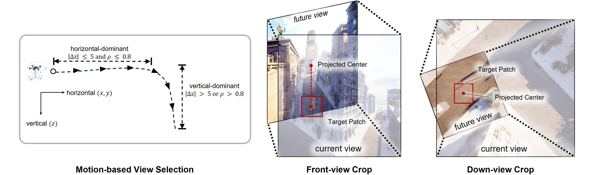

# ProtoVis-Nav

**ProtoVis-Nav: Prototypical Visual Imagination for Visual-Spatial Aligned UAV Navigation**

[Introduction](#introduction) | [Dependencies](#dependencies) | [Preparation](#preparation) | [Evaluation](#evaluation) | [Citation](#citation)

## Introduction

We introduce **ProtoVis-Nav**, a **Prototypical Visual Imagination (PVI)** framework that imagines an outcome-associated local visual representation for the intended next UAV movement. We project the next intended UAV location onto the current image plane and use the visual feature of the surrounding local region as the supervision target. The model predicts feature prototypes and uses their linear combination to estimate the target-region feature. These predicted prototypes then serve as context for waypoint prediction, promoting alignment between visual context and continuous action outputs.



*The intended next UAV location is projected into the current front or down image. A local patch around this projection provides the visual target for PVI supervision.*

## Dependencies

Use Linux with an NVIDIA GPU for AirSim/UE4 evaluation. Run the following commands from the project root:

```bash
conda create -n protovis-nav python=3.10 -y
conda activate protovis-nav
pip install torch==2.6.0 torchvision==0.21.0 --index-url https://download.pytorch.org/whl/cu118
pip install ninja packaging
pip install -r requirements_eval.txt --no-build-isolation
```

The project uses Python 3.10, PyTorch 2.6.0 with CUDA 11.8, Transformers 4.57.6, and FlashAttention. A matching CUDA toolkit is needed to build FlashAttention. For a different CUDA environment, update the PyTorch and FlashAttention requirements together.

## Preparation

Download the following models, metadata, and simulator environments:

| Asset | Contents |
| --- | --- |
| [Qwen3-VL-2B-Instruct](https://huggingface.co/Qwen/Qwen3-VL-2B-Instruct) | Base model, tokenizer, and image processor |
| [ProtoVis checkpoint](https://huggingface.co/AnonymousSubmission1111/ProtoVis) | LoRA adapter, model configuration, `non_lora_trainables.bin`, and `mm_projector.bin` |
| [Trajectory model](https://huggingface.co/wangxiangyu0814/traveluav-traj-model) | We use the TravelUAV trajectory model, `model_5.pth`. |
| [EVA-ViT-G](https://storage.googleapis.com/sfr-vision-language-research/LAVIS/models/BLIP2/eva_vit_g.pth) | `eva_vit_g.pth` |
| [TravelUAV metadata](https://huggingface.co/datasets/wangxiangyu0814/TravelUAV_data_json) | Evaluation splits, map spawn information, and object descriptions |
| [TravelUAV trajectories](https://huggingface.co/datasets/wangxiangyu0814/TravelUAV) | Episode `merged_data.json`, `mark.json`, and `object_description.json` |
| [TravelUAV environments](https://huggingface.co/datasets/wangxiangyu0814/TravelUAV_env) | AirSim/UE4 scene binaries and assets |

Place the ProtoVis checkpoint in `checkpoints/ProtoVis-Nav`, or set `MODEL_PATH` to its directory. Keep its auxiliary weight files alongside the adapter or in its immediate parent directory.

The evaluation script uses this layout by default:

```text
workspace/
  ProtoVis-Nav/
    checkpoints/ProtoVis-Nav/
    assets/clip-patch14-224/
    scripts/eval_qwen3vl.sh
  Qwen3-VL/Qwen3-VL-2B-Instruct/
  pretrained_checkpoints/travel-traj-model/model_5.pth
  Model/LLaMA-UAV/model_zoo/LAVIS/eva_vit_g.pth
  TravelUAV_data_json/data/
    uav_dataset/seen_valset.json
    uav_dataset/unseen_valset.json
    meta/map_spawnarea_info.json
    meta/object_description.json
  TravelUAV_decompressed/
  TravelUAV_envs/
```

`DATASET_PATH` points to `TravelUAV_decompressed`. Each episode must contain:

```text
scene/episode/
  merged_data.json
  mark.json
  object_description.json
```

RGB observations are obtained from the simulator during evaluation. Keep the downloaded environment folders under `TravelUAV_envs`; their executable paths are listed in `env_exec_path_dict` in [AirVLNSimulatorServerTool.py](airsim_plugin/AirVLNSimulatorServerTool.py).

## Evaluation

### 1. Start the simulator server

Run from the project root in the `protovis-nav` environment:

```bash
python airsim_plugin/AirVLNSimulatorServerTool.py \
  --root_path ../TravelUAV_envs \
  --port 25000 \
  --gpus 0
```

### 2. Run navigation

In a second terminal with the same environment, run Test Seen:

```bash
CUDA_VISIBLE_DEVICES=0 \
GPU_ID=0 \
SIM_GPU_IDS=0,0 \
MODEL_PATH=checkpoints/ProtoVis-Nav \
MODEL_BASE=../Qwen3-VL/Qwen3-VL-2B-Instruct \
DATASET_PATH=../TravelUAV_decompressed \
EVAL_JSON_PATH=../TravelUAV_data_json/data/uav_dataset/seen_valset.json \
EVAL_SAVE_PATH=outputs/seen \
SIMULATOR_TOOL_PORT=25000 \
bash scripts/eval_qwen3vl.sh
```

This example places model inference and both simulator instances on GPU 0. `CUDA_VISIBLE_DEVICES` selects the model GPU; `SIM_GPU_IDS` assigns simulator GPUs. The evaluator and server must use the same simulator port.

For Test Unseen, replace the split with `unseen_valset.json` and set `EVAL_SAVE_PATH=outputs/unseen`. Other asset locations can be set through `TRAJ_MODEL_PATH`, `VISION_TOWER`, `IMAGE_PROCESSOR`, `MAP_SPAWN_AREA_JSON_PATH`, and `OBJECT_NAME_JSON_PATH`.

Common settings in [scripts/eval_qwen3vl.sh](scripts/eval_qwen3vl.sh):

| Setting | Default |
| --- | --- |
| `BATCH_SIZE` | 2 |
| `MAX_WAYPOINTS` | 200 navigation steps |
| `PVI_TOKEN_COUNT` | 16; checkpoint configuration takes precedence |
| `STOP_PROB_THRESH` | 0.75 |
| `STOP_PROB_CONSECUTIVE` | 1 |
| `ALWAYS_HELP` / `USE_GT` | True / True, the L1 assistant setting |
| `DDP_MASTER_PORT` | 20001 |

Episode records, RGB/depth images, and termination information are written to `EVAL_SAVE_PATH`. To resume an interrupted run, use the same split and output directory; completed episodes are skipped.

### 3. Compute metrics

```bash
python utils/metric.py \
  --root_dir . \
  --analysis_list outputs/seen outputs/unseen \
  --path_type_list full easy hard
```

Use only the output directories that have been evaluated. The metric script reports Full, Easy, and Hard results:

- **NE:** navigation error, the final distance to the target in meters.
- **SR:** success rate; stopping within 20 m of the target counts as success.
- **OSR:** oracle success rate; reaching within 20 m of the target at any time.
- **SPL:** success weighted by path length.

SR, OSR, and SPL are reported as percentages.

## Citation

If you use ProtoVis-Nav in your research, please cite:

```bibtex
@inproceedings{sui2026protovisnav,
  title={ProtoVis-Nav: Prototypical Visual Imagination for Visual-Spatial Aligned UAV Navigation},
  author={Sui, Guangyuan and Hou, Yunzhong and Liu, Chi Harold},
  booktitle={Advances in Neural Information Processing Systems},
  year={2026}
}
```

## Acknowledgements

Built on [TravelUAV](https://github.com/prince687028/TravelUAV) and [Qwen3-VL](https://github.com/QwenLM/Qwen3-VL). The trajectory model uses the TravelUAV/LLaMA-UAV implementation and the [EVA](https://github.com/baaivision/EVA) visual encoder, with components from [timm](https://github.com/huggingface/pytorch-image-models), [BEiT](https://github.com/microsoft/unilm/tree/master/beit), and [DeiT](https://github.com/facebookresearch/deit).
